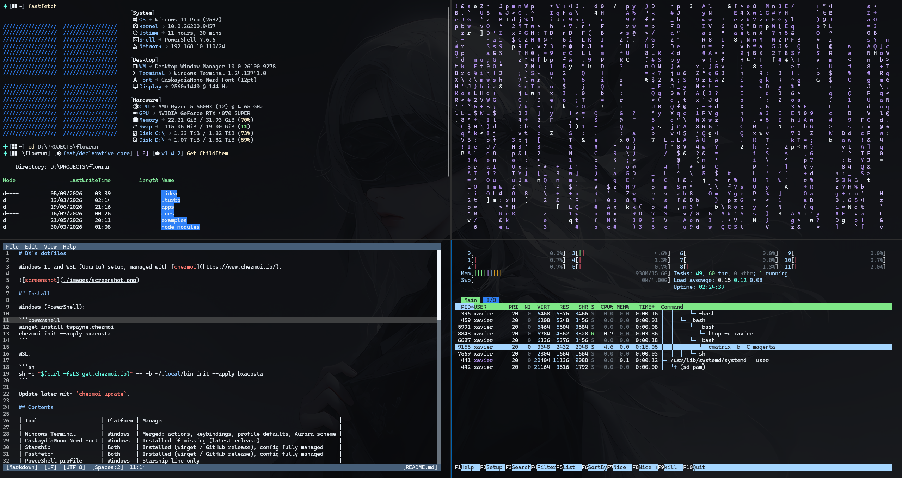

# BX's dotfiles

Windows 11 and WSL (Ubuntu) setup, managed with [chezmoi](https://www.chezmoi.io/).



## Install

Windows (PowerShell):

```powershell
winget install twpayne.chezmoi
chezmoi init --apply bxacosta
```

WSL:

```sh
sh -c "$(curl -fsLS get.chezmoi.io)" -- -b ~/.local/bin init --apply bxacosta
```

Update the configs later with `chezmoi update`. Tools are only installed when missing;
after that each one is updated its own way (`winget upgrade`, `mise self-update`, ...).

## Contents

| Tool                      | Platform | Managed                                                       |
|---------------------------|----------|---------------------------------------------------------------|
| Windows Terminal          | Windows  | Merged: actions, keybindings, profile defaults, Aurora scheme |
| CaskaydiaMono Nerd Font   | Windows  | Installed if missing (latest release)                         |
| Starship                  | Both     | Installed (winget / GitHub release), config fully managed     |
| Fastfetch                 | Both     | Installed (winget / GitHub release), config fully managed     |
| bat                       | Both     | Installed (winget / GitHub release), Aurora theme             |
| PowerShell 7              | Windows  | Installed (winget), first package                             |
| mise                      | Both     | Installed (winget / GitHub release), activated by the shells  |
| Microsoft Edit            | Windows  | Installed (winget), preferred over the System32 copy          |
| PowerShell profile        | Windows  | Shared profile line only                                      |
| Shared PowerShell profile | Windows  | Fully managed: Starship, mise, Terminal integration, aliases  |
| mise config               | Both     | `conf.d/dotfiles.toml` only (env); `config.toml` unmanaged    |
| `~/.bashrc`               | WSL      | Lines only: mise, Starship, `COLORTERM`                       |

Merged files keep everything not listed in the repo.

## Structure

```
home/                               chezmoi source (.chezmoiroot)
  .chezmoidata/                     data: terminal settings, fonts, packages
  .chezmoitemplates/bat/            bat config and Aurora theme (shared by both OSes)
  .chezmoiscripts/                  installs (winget / GitHub releases, fonts), bat cache
  AppData/.../settings.json         Windows Terminal merge template
  Documents/PowerShell/...          PowerShell profile template
  dot_config/                       Starship, Fastfetch, mise and shared PowerShell profile
  modify_dot_bashrc                 bashrc template
tools/preview-terminal-colors.ps1   color scheme preview (not installed)
```

## Colors

Defined once in the Windows Terminal `Aurora` scheme (`home/.chezmoidata/terminal.yaml`), based
on [aurora-theme](https://github.com/bxacosta/aurora-theme). Starship and Fastfetch use ANSI color names only.

## Notes

- PowerShell profile and `~/.bashrc` are created if missing.
- The shared profile must load first in PowerShell; loading Starship later overwrites existing prompt hooks.
- Paths assume packaged Windows Terminal (not Preview) and `Documents` not redirected to OneDrive.

## References

- https://github.com/LierB/fastfetch
- https://github.com/ChristianLempa/dotfiles-win
- https://github.com/Chick2D/neofetch-themes
